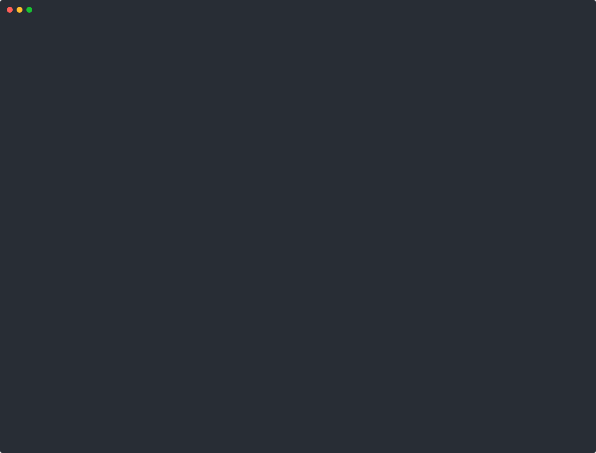

# pkgsnitch

_by [Bene Pankratz (@Beneking102)](https://github.com/Beneking102) · [benedikt-pkr.info](https://benedikt-pkr.info)_

**See what a dependency update actually does before you take it.** pkgsnitch runs the old and the new version of a package in a sandbox, watches both, and reports what the new one does that the old one did not. It also tells you which of your pinned versions are behind, in ten ecosystems.



A source diff shows what changed in the code. pkgsnitch shows what changed in the behavior: this patch release now reads `~/.ssh/id_rsa`, contacts a new host and runs `curl`. That is the signal of a hijacked package, and a version bump in a lockfile hides it.

## Commands

| You want to | Command | Ecosystems |
|---|---|---|
| Know which pinned versions are behind | `pkgsnitch outdated` | npm, Python, PHP, Rust, Go, Ruby, .NET, Java, C++ |
| Check what a dependency change brings in | `pkgsnitch lock --since origin/main` | npm, Python |
| Get a tested plan of safe updates | `pkgsnitch updates` | npm, Python |
| Check one update, or one package | `pkgsnitch diff <pkg> <old> <new>`, `pkgsnitch scan <pkg>` | npm, Python |
| Check your own release before publishing | `pkgsnitch diff old.tgz new.tgz` | npm, Python |

Python packages take a `pypi:` prefix: `pkgsnitch diff pypi:requests 2.31.0 2.32.3`. Where to put these commands (git hook, pull requests, scheduled runs, GitLab, code scanning) is in [docs/integration.md](docs/integration.md).

## Install

Requires Docker. Download a binary from the [releases](https://github.com/Beneking102/pkgsnitch/releases), or build it:

```
cargo install --git https://github.com/Beneking102/pkgsnitch
```

## How it knows

pkgsnitch does not guess from source code. It runs the package and records what happens. Each version gets a throwaway container and three phases:

1. **Fetch.** The package is downloaded without running any of its code.
2. **Install.** The network is cut. The install runs under `strace`, which records every system call the package's processes make: each file opened, each program started, each connection attempted.
3. **Import.** The package is loaded, again under `strace`.

Three things turn that recording into findings:

- **System calls** say which files were read or written and which commands ran, and by which process.
- **A sinkhole** inside the container answers every DNS query and accepts connections on ports 80 and 443. Code that phones home reveals the host and request it wanted, and nothing leaves the machine.
- **Bait.** The home directory and the environment hold worthless credentials that carry a marker. A package that opens them is reported; if the marker shows up again in a request, a DNS name or a command line, that is proof of theft.

Both versions are observed the same way and compared, so everything the package manager does on its own cancels out. Add `--explain` to any report to see the recorded call or sinkhole record behind each finding:

```
  CRITICAL  install   reads file
                      ~/.ssh/id_rsa
                      by node scripts/setup.js (in pkgsnitch-demo-leftpad)
                      reads SSH keys
                      seen: openat(AT_FDCWD</work/node_modules/pkgsnitch-demo-leftpad>, "/home/dev/.ssh/id_rsa", O_RDONLY|O_CLOEXEC) = 20
```

## Version management

```
pkgsnitch outdated                    # every dependency file in this directory
pkgsnitch outdated --recursive --fail-if major
```

Lists pinned versions that are behind their registry's latest stable release, biggest gaps first. It reads `package-lock.json`, `yarn.lock`, `pnpm-lock.yaml`, `requirements.txt`, `poetry.lock`, `uv.lock`, `composer.lock`, `Cargo.lock`, `go.mod`, `Gemfile.lock`, `packages.lock.json`, `*.csproj`, `pom.xml`, `gradle.lockfile`, `vcpkg.json`, `conanfile.txt` and `conan.lock`. `--fail-if patch|minor|major` turns it into a pipeline gate. No package code runs for this command.

For npm and Python, `pkgsnitch updates` goes further: it runs the behavioral diff for every newer version and prints a plan.

| Advice | Meaning |
|---|---|
| **apply** | Nothing new observed. The plan ends with one install line for all of these. |
| **review** | New medium-severity behavior, or a clean major version whose changelog you should read. |
| **hold** | New high or critical behavior. |

## Options

| Option | Meaning |
|---|---|
| `--format terminal\|json\|markdown\|sarif` | For people, tools, pull requests, code scanning |
| `--explain` | Show how the observation was made and the evidence behind each finding |
| `--fail-on <severity>` | Exit 1 at this severity or above (default `high`) |
| `--allow <file>` | Accepted behaviors (default `.pkgsnitch-allow` if present) |
| `--level patch\|minor\|major` | `updates`: largest version jump to propose |
| `--max <n>`, `--jobs <n>` | `updates` and `lock`: how many to evaluate, how many at once |

Exit status: `0` below the threshold, `1` at or above it, `2` on errors.

An allowlist accepts behavior you have reviewed. Matching findings stay in the report as `info`:

```
# <package>   <behavior>: <target>      (* is a wildcard)
puppeteer     DNS lookup: storage.googleapis.com
```

## Severities

| Severity | Examples |
|---|---|
| critical | sends a planted secret anywhere; reads SSH keys or cloud credentials; writes a shell profile, cron entry or git hook; runs `curl`, `wget`, `nc` |
| high | any network activity; a new install script; reads `~/.npmrc`; writes in the home directory |
| medium | starts a process; a changed install script; a new dependency with an install script |
| low | a new dependency |

A rating says how alarming it is for a package to *start* doing something. A tool that has always downloaded a binary on install produces no finding on update. On 30 real updates of widely used packages (lodash, express, typescript, next, vite, prisma and others) pkgsnitch reported nothing above `info`.

## Limits

- **It observes, it does not prove.** Code that waits for a date, checks for CI, or triggers only on a specific call stays quiet in a short run. A clean report means "nothing new was observed", not "safe".
- **Only install and import are exercised.** With the network cut, an install script that downloads a binary fails there: the attempt is reported, what the binary would do is not. Requests inside TLS are seen as a connection to a host, not by content.
- **Sandbox detection is possible**, and a container is not a hard boundary against kernel exploits. Run pkgsnitch where that is acceptable, such as a CI runner.
- **The sandbox covers npm and Python.** For the other ecosystems pkgsnitch reports outdated versions only. A Python package without a wheel is installed without its dependencies.

To try it without Docker, replay the recorded demo: `cargo run -- compare-dirs tests/fixtures/demo-old tests/fixtures/demo-new --explain`. The demo packages in `demo/` are harmless by construction. To report a vulnerability, see [SECURITY.md](SECURITY.md).

## License

MIT © 2026 Bene Pankratz
