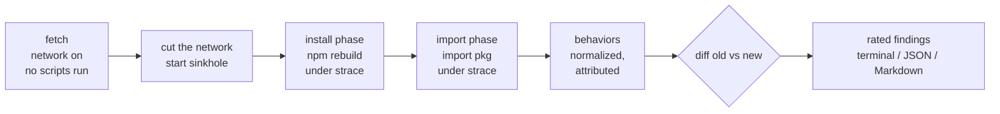

# pkgsnitch

_by [Bene Pankratz (@Beneking102)](https://github.com/Beneking102) · [benedikt-pkr.info](https://benedikt-pkr.info)_

  

**Behavioral diff and patch management for package updates.** See what a new version *does* at install and import time that the old one did not, and get a plan for which updates are safe to apply.

```
pkgsnitch diff some-package 4.2.0 4.2.1
```

A code diff tells you what changed in the source. pkgsnitch tells you what changed in the behavior: this patch release now reads `~/.ssh/id_rsa`, looks up a host it never contacted before, and runs `curl`. That is the signal that matters when a maintainer account is hijacked, and it is the one a version bump in a lockfile hides.


That is the report for the [demo pair](#try-it) in this repository, whose two versions export the exact same function. The recording replays the traces in `tests/fixtures`; reproduce it without Docker with `cargo run -- compare-dirs tests/fixtures/demo-old tests/fixtures/demo-new`.

## What it is for

| You want to | Command |
|---|---|
| Check one update before taking it | `pkgsnitch diff <package> <old> <new>` |
| See what a package does at all | `pkgsnitch scan <package>[@version]` |
| Keep a project patched without taking blind updates | `pkgsnitch updates` |
| Review a Dependabot or Renovate pull request | `pkgsnitch lock <old-lock> <new-lock>` |
| Check your own release before publishing | `pkgsnitch diff ./old.tgz ./new.tgz` |

## How it works



For each version, pkgsnitch starts a throwaway container and runs three phases:

1. **Fetch.** `npm install --ignore-scripts` downloads the package and its dependencies. No package code runs while the network is up.
2. **Install.** The network is disconnected. `npm rebuild` runs every lifecycle script under `strace`.
3. **Import.** The entry point is loaded with `import()`, again under `strace`.

During phases 2 and 3 the container has no route to anything. A sinkhole inside it answers every DNS query and accepts connections on ports 80 and 443, so code that phones home reveals the host name, TLS server name or HTTP request it wanted to send, and nothing leaves the machine. The home directory is seeded with worthless honeytoken credentials (`~/.ssh`, `~/.npmrc`, `~/.aws` and more), so code that goes looking for secrets finds something to open.

The syscall traces are reduced to normalized **behaviors**: reads of sensitive files, writes outside the places an install is expected to touch, processes started, and network activity. Each behavior is attributed to the command line responsible. The behaviors of the two versions are compared as sets, so everything npm and node do on their own cancels out, and what remains is rated.

## Install

Requires Docker. Build from source with a Rust toolchain:

```
cargo install --git https://github.com/Beneking102/pkgsnitch
```

The sandbox image is built automatically on first use.

## Usage

### One update

```
pkgsnitch diff <package> <old-version> <new-version>
pkgsnitch diff ./old.tgz ./new.tgz          # two `npm pack` tarballs
pkgsnitch scan <package>[@version]          # one version, against an empty project
```

### Patch management

```
pkgsnitch updates            # in a directory with package-lock.json
pkgsnitch updates ./app --dev --format markdown
```

`updates` asks the registry for newer versions of your direct dependencies, runs the behavioral diff for every one, and prints a patch plan:

| Advice | Meaning |
|---|---|
| **apply** | Nothing new was observed. The plan ends with the `npm install ...` line for all of these. |
| **review** | New medium-severity behavior, or a clean major version whose changelog you should read. |
| **hold** | New high or critical behavior. Do not update until it is understood. |
| **unknown** | The update could not be observed, with the reason. |

### Dependency pull requests

```
git show origin/main:package-lock.json > base.json
pkgsnitch lock base.json package-lock.json --format markdown
```

`lock` evaluates every package version that differs between two lockfiles, direct dependencies first, including the transitive ones a pull request changes without mentioning them.

As a GitHub Action (experimental):

```yaml
on: pull_request
jobs:
  pkgsnitch:
    runs-on: ubuntu-latest
    steps:
      - uses: actions/checkout@v4
      - uses: Beneking102/pkgsnitch@main
        with:
          fail-on: high
```

The report is written to the job summary, and the job fails at the chosen severity.

### Options

| Option | Meaning |
|---|---|
| `--format terminal\|json\|markdown` | Output for people, tools, or a pull request comment |
| `--fail-on <severity>` | Exit with status 1 at this severity or above (default `high`) |
| `--timeout <seconds>` | Limit per phase (default 180) |
| `--max <n>` | `updates` and `lock`: evaluate at most this many (default 20) |
| `--no-cache` | Observe again instead of reusing a stored result |

Exit status is `0` when nothing reaches the threshold, `1` when something does, and `2` on errors. JSON output carries a `schema` number that changes only with breaking changes.

Results for exact registry versions are cached, so comparing 4.2.1 with 4.2.2 next week only observes the new version.

### Try it

The repository ships a harmless demo pair: an honest `1.0.0` and a `1.0.1` that simulates a hijacked patch release. The public API is identical between the two, so a glance at the source diff waves it through; the behavior is not.

```
(cd demo/1.0.0 && npm pack) && (cd demo/1.0.1 && npm pack)
pkgsnitch diff demo/1.0.0/pkgsnitch-demo-leftpad-1.0.0.tgz demo/1.0.1/pkgsnitch-demo-leftpad-1.0.1.tgz
```

## What the severities mean

| Severity | Examples |
|---|---|
| critical | reads credentials; writes a shell profile, cron entry or git hook; runs `curl`, `wget`, `nc`; talks to the Docker socket |
| high | any DNS lookup, connection, TLS handshake or HTTP request; an install script that did not exist before; writes in the home directory |
| medium | starts a new process; an install script whose command changed; a new dependency that has an install script |
| low | a new dependency |
| info | behavior that disappeared, dependency version changes |

Severity rates how alarming it is for a package to *start* doing something. A build tool that has always downloaded a binary in its postinstall script produces no finding on update, because nothing changed.

## How it compares

| Approach | Answers | Misses |
|---|---|---|
| Vulnerability databases (`npm audit`) | Is this version known to be bad? | Anything not reported yet, which is every fresh hijack |
| Reading the source diff | What changed in the code? | Obfuscated or generated code, and it does not scale to transitive updates |
| Static scanners | Does the code contain suspicious patterns? | Behavior assembled at run time |
| **pkgsnitch** | What does it actually do when installed and loaded, and is that new? | Behavior that does not trigger in the sandbox (see below) |

These are complements. pkgsnitch adds the one view the others do not have.

## Limits

Be clear about what this does and does not tell you.

- **It observes, it does not prove.** Code that waits for a date, checks for CI variables, or only triggers on a specific call will not show its hand in a two-minute run. A clean report means "nothing new was observed", not "safe".
- **Behavior behind a failed download is not seen.** With the network gone, an install script that fetches a binary fails at that point. The attempt is reported; whatever the binary would have done is not.
- **Only install and import are exercised.** Functions you call later are out of scope.
- **Sandbox detection is possible.** Malware can notice `strace` or the container and stay quiet.
- **Containers are not a hard security boundary.** The container runs without capabilities, with `no-new-privileges` and without network, which is a strong default, but a kernel exploit would escape it. Run pkgsnitch on a machine where that risk is acceptable, such as a CI runner.
- **Trace files live where observed code can reach them.** The network log is protected by file ownership; the syscall traces are not. Code that specifically targets pkgsnitch could tamper with them.
- **npm only, for now.** The design is not specific to npm; PyPI and crates.io need their own fetch and run steps.

## Status

Alpha. The analysis pipeline (trace parsing, behavior extraction, diffing, rating, reports, patch plans) is covered by unit tests and by end-to-end tests on real `strace` recordings in `tests/fixtures`. The container sandbox is exercised by the `end-to-end` job in CI, which builds the image and must catch the demo hijack.

Planned: PyPI and crates.io, tamper-proof traces, release binaries for the GitHub Action, an allowlist file for accepted behaviors.

## Development

```
cargo test
cargo clippy --all-targets
```

| Path | Contents |
|---|---|
| `src/strace.rs` | Parser for raw strace output |
| `src/extract.rs` | Syscalls to behaviors, with process attribution |
| `src/rules.rs` | What counts as a secret, an expected write, and how to rate each behavior |
| `src/diff.rs` | Comparison of two profiles into findings |
| `src/plan.rs` | Lockfile reading, version comparison, patch plans |
| `src/sandbox.rs` | Container orchestration |
| `sandbox/` | The image: fetch and trace scripts, honeytokens, network sinkhole |
| `tests/pipeline.rs` | End-to-end tests on recorded traces, no Docker needed |

## Author

Built by **Bene Pankratz** — [@Beneking102](https://github.com/Beneking102) · [benedikt-pkr.info](https://benedikt-pkr.info)

Part of the `bene-*` security tooling collection. Issues and pull requests are welcome. To report a vulnerability, see [SECURITY.md](SECURITY.md).

## License

MIT © 2026 Bene Pankratz
